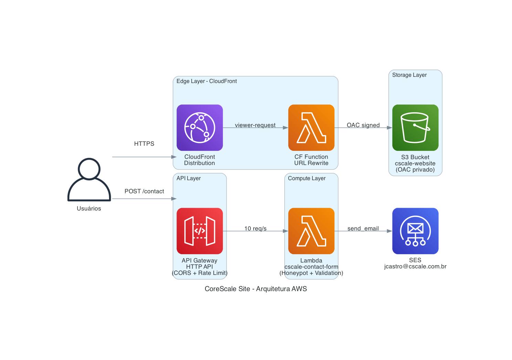

# CoreScale Site — Infraestrutura AWS

Site institucional da CoreScale em produção: **https://corescale.com.br**

## Arquitetura



### Componentes

| Componente | Recurso AWS | Função |
|-----------|-------------|--------|
| CDN | CloudFront Distribution `E100PKYXLCMDIC` | Entrega do site com HTTPS, cache e security headers |
| URL Rewrite | CloudFront Function `cscale-url-rewrite` | Resolve `/path/` → `/path/index.html` para OAC |
| Storage | S3 `cscale-website` | Armazena HTML, imagens e assets (acesso via OAC apenas) |
| API | API Gateway v2 HTTP `cscale-contact-api` | Endpoint `POST /contact` com CORS restrito e rate limiting |
| Compute | Lambda `cscale-contact-form` | Processa formulário: honeypot, validação, envio de email |
| Email | SES | Envia emails de contato para `jcastro@cscale.com.br` |
| Certificado | ACM | SSL/TLS para `corescale.com.br` + `www.corescale.com.br` |
| DNS | Route 53 (zona `Z06962061IEXT1UZMMGUD`) | ALIAS records para CloudFront |

### Fluxo — Conteúdo Estático

```
Usuário → CloudFront (HTTPS) → CF Function (URL rewrite) → S3 (via OAC assinado)
```

### Fluxo — Formulário de Contato

```
Usuário → API Gateway (CORS + throttle 10 req/s) → Lambda (honeypot + validação) → SES → email
```

## Domínios

| Domínio | Destino | Status |
|---------|---------|--------|
| `corescale.com.br` | CloudFront (ALIAS A + AAAA) | ✅ Produção |
| `www.corescale.com.br` | CloudFront (ALIAS A + AAAA) | ✅ Produção |
| `site.corescale.com.br` | CloudFront (CNAME) | ✅ Legado (ainda funciona) |

## Security Hardening

| Controle | Status | Detalhes |
|----------|--------|----------|
| HTTPS forçado | ✅ | CloudFront `redirect-to-https` |
| HSTS | ✅ | `max-age=31536000; includeSubDomains` |
| X-Frame-Options | ✅ | `DENY` (anti-clickjacking) |
| Referrer-Policy | ✅ | `strict-origin-when-cross-origin` |
| Permissions-Policy | ✅ | `camera=(), microphone=(), geolocation=()` |
| CORS restrito | ✅ | `https://corescale.com.br` + `www` |
| Rate Limiting | ✅ | 10 req/s, burst 20 (API Gateway) |
| Anti-Bot | ✅ | Honeypot field + validação server-side |
| S3 privado | ✅ | OAC — bucket inacessível sem CloudFront |
| SES verificado | ✅ | Sender + recipient verificados |
| X-Content-Type-Options | ⚠️ | Pode ser re-ativado (site Hugo é compatível) |
| Content-Security-Policy | ⚠️ | Pode ser re-ativado (site Hugo é compatível) |

## Estrutura do Repositório

```
corescale/
├── .gitlab-ci.yml           # Pipeline CI/CD (build Hugo → deploy S3 → invalidate CF)
├── .gitignore
├── README.md
├── terraform/
│   ├── main.tf              # Infraestrutura AWS completa
│   ├── variables.tf         # Variáveis (região, bucket, domínio, emails)
│   ├── outputs.tf           # Outputs (URLs, DNS records)
│   └── lambda/
│       └── contact.py       # Handler do formulário de contato
├── hugo/                    # Site institucional (Hugo SSG)
│   ├── hugo.toml            # Configuração (baseURL: corescale.com.br)
│   ├── archetypes/          # Templates para novos conteúdos
│   ├── content/
│   │   ├── _index.md        # Home
│   │   ├── blog/            # 3 artigos publicados
│   │   ├── cases/           # 4 cases de clientes
│   │   ├── ia-generativa.md # Landing page IA
│   │   ├── msp.md           # Landing page MSP
│   │   ├── pagamento-boleto.md # Landing page Boleto
│   │   ├── migracao-vmware-aws.md
│   │   └── privacidade.md
│   ├── layouts/
│   │   ├── index.html       # Home (hero, serviços, MAP, parceria, métricas, contato)
│   │   ├── _default/baseof.html  # Base template (fonts, CSS, JS, mobile menu)
│   │   ├── partials/        # Header (com hamburger), footer, CTA
│   │   ├── blog/            # List + single templates
│   │   ├── cases/           # List + single templates
│   │   ├── ia-generativa/   # Landing page IA Generativa
│   │   ├── msp/             # Landing page Operação Gerenciada
│   │   ├── pagamento-boleto/ # Landing page Pagamento Boleto
│   │   └── migracao/, privacidade/
│   └── static/              # Imagens, favicon, robots.txt
├── contact.html             # Formulário standalone (legacy)
├── deploy.sh                # Script de deploy manual
└── generated-diagrams/      # Diagramas de arquitetura (.png + .drawio)
```

## CI/CD — GitLab Pipeline

**Repositório:** `https://git.corescale.com.br/corescale/products/site-institucional`  
**Branch de deploy:** `main`  
**Runner:** `gitlab-runner-1` (Docker executor, self-hosted)

A pipeline roda automaticamente em **todo push para `main`**:

```
git push origin main → build (hugo --minify) → deploy (s3 sync + CF invalidation)
```

### Stages

| Stage | Imagem | Ação |
|-------|--------|------|
| `build` | `debian:bookworm-slim` | Instala Hugo Extended 0.163.3, roda `hugo --minify`, gera artefatos |
| `deploy` | `amazon/aws-cli:latest` | `aws s3 sync` → `aws cloudfront create-invalidation` |

### Por que Debian e não Alpine?

Hugo Extended usa `libstdc++` e `libgcc_s` (glibc). Alpine usa musl e não é compatível — mesmo com `libc6-compat` ou `gcompat`, os símbolos C++ não resolvem. Debian Bookworm-slim resolve nativamente.

### Configuração no GitLab

**Settings → CI/CD → Variables:**

| Variável | Tipo | Descrição |
|----------|------|-----------|
| `AWS_ACCESS_KEY_ID` | Protected, Masked | IAM user `gitlab-site-deploy` |
| `AWS_SECRET_ACCESS_KEY` | Protected, Masked | IAM user `gitlab-site-deploy` |

### IAM User de Deploy

| Campo | Valor |
|-------|-------|
| **User** | `gitlab-site-deploy` |
| **Conta** | `024958414549` |
| **Policy** | `site-deploy-policy` (inline) |

**Permissões (princípio do menor privilégio):**

```json
{
  "Version": "2012-10-17",
  "Statement": [
    {
      "Effect": "Allow",
      "Action": ["s3:PutObject", "s3:DeleteObject", "s3:ListBucket", "s3:GetObject"],
      "Resource": ["arn:aws:s3:::cscale-website", "arn:aws:s3:::cscale-website/*"]
    },
    {
      "Effect": "Allow",
      "Action": "cloudfront:CreateInvalidation",
      "Resource": "arn:aws:cloudfront::024958414549:distribution/E100PKYXLCMDIC"
    }
  ]
}
```

## Deploy Manual

### Site Hugo (conteúdo)

```bash
cd hugo
hugo --minify
aws s3 sync public/ s3://cscale-website/ --delete --cache-control "max-age=300"
aws cloudfront create-invalidation --distribution-id E100PKYXLCMDIC --paths "/*"
```

### Infraestrutura (Terraform)

```bash
cd terraform
terraform init
terraform apply
```

## Configuração

### Variáveis Terraform

| Variável | Valor | Descrição |
|----------|-------|-----------|
| `aws_region` | `us-east-1` | Região AWS |
| `bucket_name` | `cscale-website` | Bucket S3 |
| `domain_name` | `corescale.com.br` | Domínio produção |
| `contact_email` | `jcastro@cscale.com.br` | Destinatário dos emails |
| `sender_email` | `site@cscale.com.br` | Remetente SES |

### SES (Email)

SES em **sandbox mode**. Emails verificados:
- `site@cscale.com.br` — remetente
- `jcastro@cscale.com.br` — destinatário

Para enviar para qualquer destinatário: AWS Console → SES → Request Production Access.

### DNS (Route 53 — profile `corescale-admin`)

| Registro | Tipo | Valor |
|----------|------|-------|
| `corescale.com.br` | A (ALIAS) | `d32opakjll1yhp.cloudfront.net` |
| `corescale.com.br` | AAAA (ALIAS) | `d32opakjll1yhp.cloudfront.net` |
| `www.corescale.com.br` | A (ALIAS) | `d32opakjll1yhp.cloudfront.net` |
| `www.corescale.com.br` | AAAA (ALIAS) | `d32opakjll1yhp.cloudfront.net` |

## Lambda — Formulário de Contato

O handler (`terraform/lambda/contact.py`) implementa:

1. **CORS condicional** — `Access-Control-Allow-Origin` apenas quando `Origin == https://corescale.com.br`
2. **Honeypot** — campo `website` verificado raw (sem trim); se não-vazio = bot → retorna 200 silenciosamente
3. **Validação** — `name` (2-200 chars), `email` (@ + dot no domínio), `message` (10-5000 chars)
4. **Envio** — SES `send_email` apenas quando honeypot vazio + validação OK

### Respostas

| Cenário | Status | Body |
|---------|--------|------|
| Bot detectado | 200 | `{"message": "Mensagem enviada com sucesso!"}` |
| Validação falhou | 400 | `{"error": "Campo 'X' ..."}` |
| Sucesso | 200 | `{"message": "Mensagem enviada com sucesso!"}` |
| Erro SES | 500 | `{"error": "Erro ao enviar mensagem..."}` |

## Hugo — Publicar Conteúdo

### Novo blog post

```bash
cd hugo
hugo new content blog/meu-artigo.md
```

Editar front matter:
```toml
title = "Título do Artigo"
date = 2026-07-05
draft = false
category = "FinOps"  # FinOps, Migração, MAP, Segurança, IA, Operação
description = "Resumo de 1-2 frases."
banner_gradient = "#1A1A2E, #16213E, #0F3460"
banner_icon = ''
```

### Novo case

```bash
hugo new content cases/meu-case.md
```

### Dev server local

```bash
hugo server -D    # http://localhost:1313
```

## Histórico de Mudanças

### Julho 2026 — Novas Landing Pages + CI/CD Automatizado

- **Novas páginas:** IA Generativa (`/ia-generativa/`), MSP (`/msp/`), Pagamento Boleto (`/pagamento-boleto/`)
- **Case Dalpozzo:** adicionado case de migração MAP (`/cases/varejo-migracao-aws-map/`)
- **Formulário de contato:** migrado de `mailto:` para `fetch` na API Gateway (Lambda + SES)
- **Menu mobile:** botão hamburger (☰) com drawer para navegação em telas < 1000px
- **Links de serviços:** tiles da home agora linkam para as landing pages
- **CI/CD:** pipeline GitLab (debian:bookworm-slim + Hugo Extended + AWS CLI)
- **IAM:** criado user `gitlab-site-deploy` com permissões mínimas (S3 + CloudFront)
- **Favicon:** atualizado

### Julho 2026 — Go-Live Produção

- **Domínio:** migração `site.corescale.com.br` → `corescale.com.br` (produção)
- **ACM:** novo certificado para `corescale.com.br` + `www.corescale.com.br`
- **DNS:** Route 53 ALIAS records (A + AAAA) para CloudFront
- **CORS:** atualizado para `https://corescale.com.br`
- **CI/CD:** pipeline GitLab (build Hugo → S3 sync → CF invalidation)
- **Conteúdo:** 8 blog posts, 3 cases, landing page migração
- **Layout:** serviços expandidos (8 tiles), menu mobile hamburger, seção Nossa História
- **Blog:** banners com ícones oficiais AWS, cards com fundo branco

### Julho 2026 — Security Hardening

- Migração S3 website hosting → OAC (bucket privado)
- CloudFront Response Headers Policy (HSTS, X-Frame-Options, Referrer-Policy, Permissions-Policy)
- CloudFront Function para URL rewrite (`/path/` → `/path/index.html`)
- API Gateway: CORS restrito, rate limit 10 req/s burst 20
- Lambda: CORS condicional, honeypot anti-bot, validação enhanced
- Formulário de contato via API (substituiu mailto)
- SES: verificação sender + recipient
